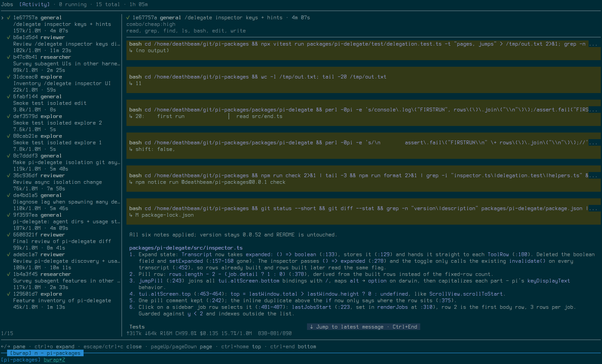

# [@deathbeam/pi-delegate](https://www.npmjs.com/package/@deathbeam/pi-delegate)

Run subagents in the background with `delegate`, and manage them with `delegate_list`, `delegate_steer`, `delegate_cancel`, `delegate_apply`, and `delegate_discard`.
`/delegate` opens a fullscreen inspector for live and recent jobs.



## Installation

```sh
# Choose one:
pi install npm:@deathbeam/pi-delegate            # this package
pi install git:github.com/deathbeam/pi-packages  # all my packages
```

## Configuration

Optional `delegate` settings live in `~/.pi/agent/settings.json` or `.pi/settings.json`:

```json
{
    "delegate": {
        "agentDirs": ["../shared/agents"],
        "models": {
            "cheap": "anthropic/claude-haiku-5-5:low",
            "balanced": "anthropic/claude-sonnet-5-5:high",
            "strong": "anthropic/claude-opus-5-5:high"
        }
    }
}
```

- `agentDirs` adds agent directories on top of the defaults: bundled, `~/.agents/agents`, `~/.pi/agent/agents`, `.agents/agents` from the working directory up to the git root, then `.pi/agents`. Later wins on a name clash. Project dirs and `.pi/settings.json` load only in a trusted project.
- `models` maps alias names to a `provider/model-id` with an optional `:<thinking>` suffix. The bundled agents use `cheap`, `balanced`, and `strong`, so configure those. A `model` value with a `/` is a literal `provider/model` id, never an alias; an unset alias falls back to the session model, with a warning.

Agents are Markdown files with frontmatter. The body is appended to the delegate's system prompt.

```markdown
---
name: scout
description: Explore the codebase
tools: read, grep
model: cheap
isolated: false
---

Explore the codebase and report relevant paths.
```

- `name` is required and must be unique.
- `description` is required.
- `tools` is optional, a comma-separated list of tool names. Defaults to the session tools.
- `model` is optional, an alias name or a `provider/model[:thinking]` id. Defaults to the session model.
- `isolated` is optional and defaults to `false`. See [Isolation](#isolation).

## Isolation

`isolated: true` (on a `delegate` call or in agent frontmatter) runs the delegate in its own git clone at
`.pi/worktrees/<job id>`, starting from your current working tree including uncommitted changes.

`delegate_apply` merges the result into your working tree as uncommitted changes.
`delegate_discard` discards the clone and its changes.

Any later delegate can share that clone with `clone: <job id>`, for review, tests, or follow-up work.

## Development

From the repo root:

```sh
npm install
npm test -- packages/pi-delegate
pi install ./packages/pi-delegate
```
