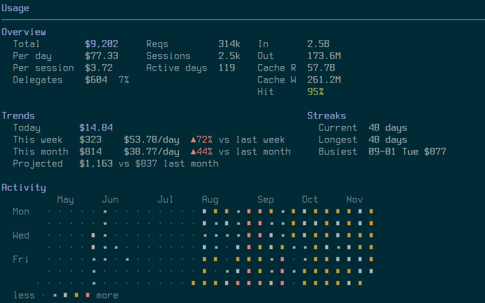

# [@deathbeam/pi-usage](https://www.npmjs.com/package/@deathbeam/pi-usage)

Use the `/usage` command for a fullscreen dashboard of token usage and cost. It opens on a Summary and has per-day, per-provider, per-model and per-project views.



## Installation

```sh
# Choose one:
pi install npm:@deathbeam/pi-usage               # this package
pi install git:github.com/deathbeam/pi-packages  # all my packages
```

## Development

From the repo root:

```sh
npm install
npm test -- packages/pi-usage
pi install ./packages/pi-usage
```
